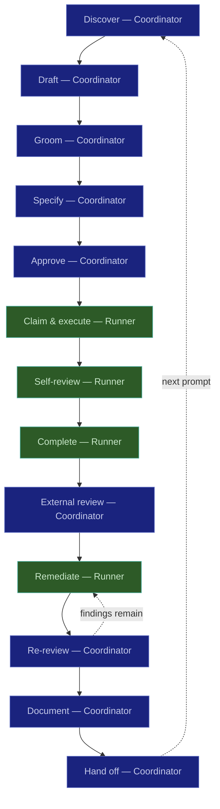
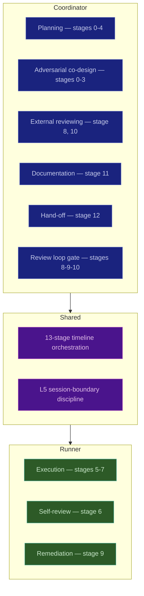

# Crafted-Prompt Development (CPD)

> A methodology for building software with coding agents.

The core artifact is the **crafted prompt** — a structured, reviewed,
agent-friendly brief that an agent consumes and executes.

## Contents

- [Why CPD](#why-cpd)
- [Principles](#principles)
- [What CPD does not replace](#what-cpd-does-not-replace)
- [The Flow](#the-flow)
  - [The 13-stage timeline](#the-13-stage-timeline)
  - [The review loop](#the-review-loop-stages-8-9-10)
  - [Two-round review](#two-round-review)
- [Roles](#roles)
  - [Coordinator](#coordinator-planner--reviewer)
  - [Runner](#runner-executor--fixer)
  - [Responsibility Venn](#responsibility-venn)
  - [Why two agents?](#why-two-agents)
- [How the flow maps to CPD principles](#how-the-flow-maps-to-cpd-principles)
- [License](#license)

---

## Why CPD

Spec-driven development front-loads formal specification at a point where you
know the least about the problem. Agentic coding is strongest at back-loaded
iteration — reading code, running tests, discovering the design through doing.

CPD bridges this gap: it takes the discipline of spec-driven development
(thinking before building, reviewing before executing) and reshapes it around
how agents actually work.

---

## Principles

### 1. Discover before specifying — explore before committing

Before writing specifications or prompts, hold a chat session. Explore
possibilities, challenge assumptions, and let the problem space breathe.
The first part of the process is organizing thoughts and understanding
the goals — not committing to a structure.

---

### 2. Living context documents — patterns that survive across prompts

A crafted prompt describes the problem and how it should be addressed, but
it doesn't carry the full context. Each prompt needs surrounding
documentation that **survives across execution sessions and prompts**:
`AGENTS.md` (or equivalent), `DESIGN.md`, `ARCHITECTURE.md`, or whatever other
documents fit the project.

These documents carry the patterns, conventions, and accumulated context
that no single prompt can hold. They ensure consistency across the
lifecycle of executions. Keep them updated.

---

### 3. Minimal ceremony by default

Add weight only when risk justifies it. Most work doesn't need formal
requirements matrices, architecture diagrams, or exhaustive risk analyses.
The default is lightweight — a clear intent, a defined scope, and falsifiable
ACs. Heavy ceremony is a deliberate escalation, not the baseline.

---

### 4. Size-aware routing — smallest artifact first

Not all work needs the same container. A one-line fix does not need a prompt
with 16 acceptance criteria. A vague idea does not need an implementation plan.
When in doubt, choose the smallest artifact that fits. Forcing large ceremony
onto small work is more damaging than missing ceremony on large work.

---

### 5. Promotion over premature ceremony

Start small, grow later. A quick idea can become a prompt. A small fix can
become a full decomposed plan. The path from light to heavy is one-way and
validated — you never need to know the full scope upfront. Don't force a large
artifact onto work that doesn't yet need it.

---

### 6. The prompt is the primary artifact — and it survives its execution

A prompt is not a formal specification. It is a **crafted prompt** — a
document designed to be consumed by a coding agent. Its quality is measured
by how useful it is to the agent executing it, not by how formally complete it
is.

The prompt is also the **durable record of the work**. Once approved, it
survives the execution lifecycle and grows with it:

- **The problem and intent are immutable** during execution — the agent
  refines how the work is done, not what is being solved.
- **The execution approach is open to refinement** — suggested steps and
  guidance can be adjusted as unforeseen problems surface. Each adjustment
  is captured on the prompt itself.
- **The prompt carries the audit trail** between code reviews (see principle 13):
  gaps found, fixes applied, deferrals, and remaining work.

After planning, the prompt is the single place to look for where the work
stands — done, in flight, deferred, or learned.

---

### 7. Compose, groom, review — then execute

A prompt is not a chat message. Before it goes to execution, it goes through
a deliberate craft cycle:

- **Compose** — write the prompt: intent, problem, scope, acceptance
  criteria, suggested guidance.
- **Groom** — challenge the prompt: stress-test scope boundaries, verify
  ACs are falsifiable, decompose into work packages when needed.
- **Review** — a human reads the prompt and asks: "would I trust a capable
  agent with this prompt as it stands?" Approval is the gate to execution.

Once the prompt passes review, it goes to execution. Review of the **executed
code** is a separate discipline — see principle 13.

---

### 8. Prompts define intent, not implementation

A CPD prompt defines the **intent**, the **problem**, the **scope** (including
what is out of scope), and **acceptance criteria**. It does not pretend to be a
blueprint or a system design document. Architecture and design emerge during
execution and are captured in the code.

Suggested steps and implementation instructions are a **proposed solution** —
a starting point for the agent. The agent should follow them unless it
discovers a better path. When it does deviate, the note lives on the
prompt itself — part of the audit trail (principle 6) and forward-feeding into
future prompt crafting (principle 12).

---

### 9. Verification is auditable, not aspirational

Acceptance criteria answer "did we solve the problem?" rather than "did we
follow the spec?" They are executable verifications — test commands, manual
checks, or observable behaviors — that confirm the problem described in the
prompt is resolved.

Evidence is recorded as commands and exit codes, not narrative descriptions.
"The tests pass" is a claim. `cargo test -p foo -- exit 0` is evidence.
Bypass is recorded as explicit debt.

---

### 10. Scope-down visibility — flag partial scope loudly

When shipping partial scope, declare what was deferred. A prompt marked "done"
that silently ships 60% of the intended scope is a broken contract. The
reviewer needs to see a per-AC checklist of what was shipped and what remains.
Partial scope is legitimate; hidden scope is not.

---

### 11. Green tests don't imply correct behavior

A passing test suite is a precondition for code review, not the conclusion.
Review must independently try to break the change — different inputs, edge
cases, adversarial paths. A review that only checks "do tests pass?" is a smoke
test, not a review. Multiple review passes with different mental frames
(spec compliance, edge cases, empirical) surface uncorrelated bugs.

---

### 12. Agent discoveries feed forward to future prompt crafting

When an agent discovers something during execution that contradicts or expands
the prompt's assumptions, that discovery is captured as a note or finding. This
forward-feeds into future prompt crafting.

Distinct from principle 14: #12 captures **agent** discoveries as notes that
improve the craft process; #14 turns **human-validated** tweaks into follow-up
crafted prompts.

---

### 13. Code review by agents is non-negotiable

Code review ensures the executed work matches the crafted prompt's intent.
The agent that produced the code is **not** the only reviewer — multiple
passes catch uncorrelated bugs:

- **Round 1: runner self-review.** The agent that wrote the code reviews
  its own work before handing off. Catches obvious issues but is
  structurally biased.
- **Round 2: external agent review.** A fresh agent — ideally running a
  **different model** — reviews for correctness, security, design quality,
  and alignment with prompt intent. A different model brings a different
  lens and surfaces uncorrelated bugs. Strongly recommended.

**Human review is welcome but optional.** The pace and volume of agentic
code make line-by-line human review impractical. Humans add the most value
when they focus on **architectural decisions**, **cross-prompt integration**,
and judgment calls the agents can't make — not on auditing every diff.
Humans may request changes; they may also defer to clean agent reviews.

Code review by agents is mandatory. Code review by humans is an extra.

---

### 14. Human validation and incremental refinement

A crafted prompt is a unit of work, not the final word. After execution, the
human validates the outcome against intent and decides how to proceed: accept,
revise, or refine. Small adjustments — edge cases, polish, naming, UX tweaks,
wording fixes — are **follow-up crafted prompts**, not silent edits to the
original artifact. Each follow-up is itself a prompt: small in scope,
falsifiable, reviewed, and executed.

This creates an **incremental refinement loop** in which:

- The original prompt remains the record of original intent.
- Refinements live in their own traceable units (their own brief, ACs,
  evidence, review).
- The human stays in the loop at the seam between executions — not as a
  bystander, and not as a micromanager, but as the validator who decides
  whether the work is done or what to ask next.

CPD's quality loop (review, evidence, ACs) operates **inside** one prompt.
The human's validation operates **across** prompts — it is the seam that
lets CPD compose cleanly into long-running collaboration instead of
collapsing into a single mega-prompt.

---

## What CPD does not replace

- **Line-by-line human code review** — humans add the most value on
  architectural decisions and cross-prompt integration (see principle 13).
  Agents do the heavy review.
- **Strategic backlog management** — CPD is about daily developer-agent
  workflow, not product-level roadmap.
- **Architectural thinking** — it lives in the prompts and the reviewer's
  brain, not in a separate artifact. The code is the architecture.

---

## The Flow

CPD is executed through a structured lifecycle — a 13-stage timeline that
takes a crafted prompt from creation to delivery. Each stage is owned by a
specific role. Execution moves through the stages sequentially, with clear
hand-offs at each boundary and a review loop that iterates until clean.

### The 13-stage timeline

- 🟢 **Green** = Runner-owned stages (5, 6, 7, 9)
- 🔵 **Blue** = Coordinator-owned stages (0, 1, 2, 3, 4, 8, 10, 11, 12)
- **Solid arrows** = forward flow; **dotted arrow** = re-review loop back to remediate (stage 10 → stage 9)
- **Dotted return to stage 0** = next crafted prompt, typically after human validation of the previous outcome (see principle 14). Small follow-up prompts may skip stage 0 when scope is clear.

| Stage | What happens |
|------:|--------------|
| 0. Discover (coord) | Hold a chat session: explore the problem, challenge assumptions, organize thoughts, understand goals. No prompt yet — see principle 1. |
| 1. Draft (coord) | Write the prompt: intent, problem, scope, ACs, design decisions. The ACs and scope defined here are the key inputs to the downstream code review. |
| 2. Groom (coord) | Challenge the prompt: stress-test scope boundaries, verify AC falsifiability. Decompose into work packages and guidance steps. |
| 3. Specify (coord) | Lock the prompt for execution: open questions must be resolved, prompt status set to `ready`. |
| 4. Approve (coord) | Pass the readiness gates. The approved prompt is ready for a runner to claim. |
| 5. Claim & execute (runner) | Claim the prompt, implement the code, follow guidance steps (or deviate with a note), pass ACs with evidence. |
| 6. Self-review (runner) | Round-1 self-review: pre-screen with lesson patterns, file self-findings. Catches obvious issues before handing off. |
| 7. Complete (runner) | Mark the prompt complete; lifecycle transitions to `self-reviewed`. |
| 8. External review (coord) | Round-2 external review: examine diff, verify tests, check alignment with prompt intent. File findings for the runner to remediate. |
| 9. Remediate (runner) | Address review findings, fix code, re-run verification commands, mark findings resolved. |
| 10. Re-review (coord) | Verify remediations, confirm all findings are closed. If new issues are found, loop back to stage 9. Clean = advance to stage 11. |
| 11. Document (coord) | Capture lessons learned, document guidance deviations, record evidence. |
| 12. Hand off (coord) | Mark the prompt complete and closed. Archive the results or prepare for the next prompt cycle. The human validates the outcome and decides whether to accept, revise, or refine via a follow-up crafted prompt (see principle 14). |

---

### The review loop (stages 8-9-10)

Stages 8 (External review), 9 (Remediate), and 10 (Re-review) form an
**iterative loop**: a clean stage 10 advances to stage 11 (Document);
a stage 10 that finds new findings returns to stage 9 (Remediate) for
another pass. The coordinator controls the gate: only the coordinator
decides when the loop exits.

---

### Two-round review

The review is the heart of CPD's quality loop. It runs in two distinct rounds
with a hard session boundary between them:

- **Round 1 (runner, self-reviewed — stage 6):** The runner reviews its own
  work before handing it off. This catches obvious issues — missed ACs,
  compilation failures, test breakage — but is inherently unreliable for
  deeper quality assessment. The runner files self-findings and marks the
  prompt complete (stage 7), which transitions the lifecycle to `self-reviewed`.

- **Round 2 (coordinator, externally-reviewed — stage 8):** An independent
  agent reviews the implementation. This is a real code review — security,
  correctness, design quality, alignment with prompt intent. The coordinator
  was not involved in the implementation and brings fresh eyes. **The
  coordinator is ideally powered by a different model from the runner** —
  the model diversity is what catches uncorrelated bugs (see principle 13).
  The coordinator controls the review loop exit (stage 10).

> **L5 rule:** Same-session self-review is unreliable. The runner session that
> produces code (stages 5–7) is never the same session that fixes findings
> (stage 9). The coordinator's review session (stages 8, 10) is never the same
> session that planned the prompt (stages 0–4). The boundary is structural,
> not a matter of discipline.

---

## Roles

CPD splits work across two agents, each with its own identity and
accountability. This separation is structural — it prevents the cognitive
collapse that happens when one agent both plans and evaluates.

### Coordinator (planner + reviewer)

The coordinator **does not write code**. It owns the quality of the prompt and
the quality of the review.

**Responsibilities:**

- **Planning** — compose and groom prompts: interview stakeholders, set scope
  boundaries, define acceptance criteria.
- **Adversarial co-design** — stress-test prompts before execution. Catches
  weak scopes, vague ACs, and ambiguous intent before the runner sees them.
- **Reviewing** — post-execution code review: correctness, security, design
  quality, alignment with prompt intent. The coordinator is ideally powered
  by a different model from the runner — the model diversity is what catches
  uncorrelated bugs (see principle 13).

**Owns stages:** 0 (Discover), 1 (Draft), 2 (Groom), 3 (Specify), 4 (Approve),
8 (External review), 10 (Re-review), 11 (Document), 12 (Hand off).

---

### Runner (executor + fixer)

The runner **executes prompts and fixes findings**. It does not plan new work
or evaluate its own output as the final word.

**Responsibilities:**

- **Execution** — claim a prompt, read it, implement the code, follow guidance
  steps (or deviate with a note), pass ACs, run tests, complete the work.
  Produces evidence — not prose, but command output and exit codes.
- **Remediation** — receive coordinator findings, patch the code, re-run
  verification commands, mark findings resolved. Does not close the review
  loop — hands back to coordinator for re-review.

**Owns stages:** 5 (Claim & execute), 6 (Self-review), 7 (Complete),
9 (Remediate).

---

### Responsibility Venn

- 🔵 **Blue** = Coordinator-only
- 🟣 **Purple** = Shared across both agents
- 🟢 **Green** = Runner-only

---

### Why two agents?

A single agent that plans, writes, and reviews its own code has a blind spot:
it cannot evaluate its own work critically. CPD makes the plan-review boundary
a structural guarantee, not a matter of discipline. The coordinator can ask
"did this solve the problem?" without the bias of having written the solution.

---

## How the flow maps to CPD principles

| Principle | Flow stage |
|-----------|------------|
| Discover before specifying | Stage 0 (Discover — chat/explore before committing to a prompt) |
| Living context documents | Cross-stage (`AGENTS.md`, `DESIGN.md`, `ARCHITECTURE.md` maintained throughout the project lifecycle) |
| Minimal ceremony by default | Stages 0–4 (lightweight prompt, escalate when risk justifies weight) |
| Size-aware routing | Stage 0–1 (Discover — pick the smallest artifact that fits, then Draft it) |
| Promotion over premature ceremony | Stage 0–2 (Discover → Draft → Groom — start small, promote when scope demands it) |
| The prompt is the primary artifact — and it survives its execution | Stage 1 (write intent/problem/scope/ACs); stages 5–12 (durable record — execution refinements, audit trail between reviews, deferrals and remaining work) |
| Compose, groom, review — then execute | Stages 1–4 (compose → groom → review; execution begins at stage 5) |
| Prompts define intent, not implementation | Stage 1 (define intent/problem/scope/ACs, not architecture) + Stage 5 (steps are guidance, runner follows or deviates with a note captured on the prompt) |
| Verification is auditable, not aspirational | Stage 5 (ACs as executable verifications; evidence as commands + exit codes, not prose) |
| Scope-down visibility | Stage 11 (document what was deferred during execution) |
| Green tests don't imply correct | Stage 8 (coordinator adversarial review beyond pass/fail) |
| Agent discoveries feed forward to future prompt crafting | Stage 11 (document lessons, guidance deviation notes) |
| Code review by agents is non-negotiable | Stages 6 + 8 + 10 (round-1 self-review, round-2 external review on a different model; humans add value on architecture and integration) |
| Human validation and incremental refinement | After stage 12 (Hand off) — human validates outcome; small tweaks are follow-up crafted prompts looping back to stage 0 (Discover) or stage 1 (Draft) |

---

## License

This methodology is shared as a reference for the agentic-coding community.
Use it, adapt it, evolve it.