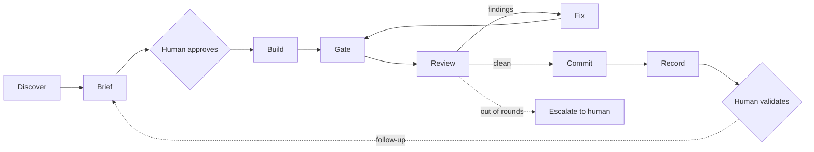

# Delegate & Verify

> A guideline for building software with coding agents: brief the work,
> delegate it, verify it with evidence.

Harness-agnostic. It defines roles, contracts and quality bars; any setup that
can run fresh-context agents and hand off files can implement it (see
[harness.md](harness.md)).

- [The loop](#the-loop)
- [Roles](#roles)
- [Principles](#principles)
- [Tiers](#tiers)
- [Documents](#documents)

---

## The loop

One **unit** = one brief = one reviewable diff = one commit.

---

## Roles

| Role | Does | Never |
|---|---|---|
| **Human** | Sets goals, approves briefs, rules on decisions of record, validates outcomes | Audits every diff |
| **Orchestrator** | Discovers, decomposes, briefs, triages findings, commits, records | Writes or reviews the unit's code |
| **Builder** | Implements one brief, runs the gate, writes a report | Commits, widens scope, asks interactively |
| **Reviewer** | Verifies the change against the brief, writes findings and a verdict | Edits code |

Builder and reviewer are fresh agents with their own context. A cheap builder
with a strong reviewer is a good default.

---

## Principles

1. **Context lives in files, not sessions.** Briefs, reports and reviews are
   files. Any agent can be replaced mid-loop; nothing important lives only in
   a transcript.
2. **Brief intent; prescribe in proportion to the builder.** Always state
   the outcome, the scope and what's out of scope. Add steps when the builder is
   weak or the path is risky. See [briefing.md](briefing.md).
3. **Done means evidence.** Acceptance criteria are commands or observable
   checks. `cargo test -p foo → exit 0` is evidence; "tests pass" is a claim.
4. **Gate before review.** Lint, typecheck, tests and AC commands run
   deterministically. They replace self-review.
5. **The author never verifies.** Review is done by a different agent with fresh
   context, against the brief, not against the builder's report.
6. **Reviews find defects, not taste.** Every finding has a location, a
   concrete failing scenario and a severity. No nits. See
   [verifying.md](verifying.md).
7. **Loops are bounded.** Cap the review rounds (e.g. 5). When the cap is hit,
   the orchestrator decides small reversible issues; everything else goes to
   the human.
8. **Partial scope is declared.** Reports list every AC as done or not done.
   Shipping partial scope is fine; hiding it is not.
9. **Smallest ceremony that fits.** Pick the lightest [tier](#tiers) and
   move up only when risk demands it.
10. **Lessons become rules.** A finding that recurs becomes a line in the
    builder rules, the review rules or `AGENTS.md`. Notes that nobody reads
    again don't count.
11. **The human works at the seams.** Approving intent and validating outcomes
    are where human attention pays off most. Line-by-line review of agent diffs
    is optional.

---

## Tiers

| Tier | When | Flow |
|---|---|---|
| **Trivial** | One file, obvious fix, no behaviour change | Do it → gate → commit |
| **Standard** | Default | Brief → build → gate → one reviewer loop → commit |
| **Heavy** | Public API, data model, security, migrations, >1 module, unclear intent | Discover → plan → units → human approves briefs → standard loop per unit → second review frame (edge cases / security) |

Move a unit up a tier when it surprises you. Never move it down mid-flight.

---

## Documents

| File | Covers |
|---|---|
| [contracts.md](contracts.md) | Required fields of brief, report, review and record |
| [briefing.md](briefing.md) | How to write a brief an agent can execute |
| [verifying.md](verifying.md) | How to review, triage and close a unit |
| [harness.md](harness.md) | What an implementation must provide; known failure modes |

Status: draft. The briefing and verifying guides should be refined with
evidence from real runs (see [verifying.md](verifying.md#learn-from-runs)).

## License

Shared as a reference for the agentic-coding community. Use it, adapt it,
evolve it.
